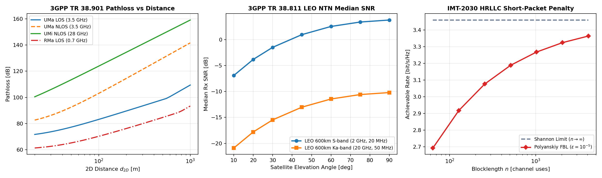
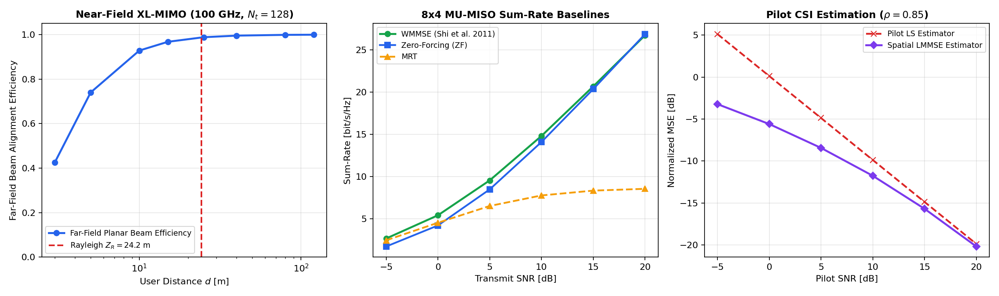

# WannaDo-WCE (`wannado-wce`)

*Wanna do a wireless communication simulation?*

*This library enables you to set up your fundamental wireless communication environment while chatting with your IDE, preventing hallucinations and strictly adhering to 3GPP and ITU standards*

**Standards-Anchored, Just-in-Time (JIT) Wireless Communication Environment Quick Provisioning for 5G-Advanced, 6G / IMT-2030, ISAC, RIS, Near-Field XL-MIMO, NTN, UAV, V2X, and AI-Native Networks**

[](https://github.com/JietaoZhao/wannado-wce/blob/main/pyproject.toml)
[](https://github.com/JietaoZhao/wannado-wce/blob/main/pyproject.toml)
[](#1-authoritative-standards--scenario-matrix-21-standards--6-imt-2030-scenarios)
[](#2-the-33-block-single-file-arsenal-classic--2025-frontier)
[](https://github.com/JietaoZhao/wannado-wce/blob/main/LICENSE)

---

**Stop guessing wireless simulation setups or hand-stitching incompatible channel scripts.** Tell your AI Coding Assistant (Antigravity, Claude Code, Codex CLI, or Cursor) what communication research you want to do, and `wannado-wce` follows a strict **5-Stage Standards-Anchored Provisioning Protocol** inside an isolated `./wce_lab/` boundary:

1. **Traverses & Diagnoses First**: Reads your workspace (`torch`, `gymnasium`, ray-tracing configs, sibling `./drl_lab/` or `./adv_eval/`) and infers a Stage 0 `WCESpec`.
2. **Anchors Every Knob to Authority**: Maps **every physical setting** (pathloss, LoS probability, NR numerology, O2I loss, antenna spacing, Doppler, traffic queue, clutter/RCS) to **21 codified ITU-R / 3GPP / ETSI / IEEE standards** and canonical papers.
3. **Executes Just-in-Time (JIT) Assembly**: Uses fast built-in PyTorch/NumPy **Tier 0** kernels immediately, while recommending and scripting exact pull commands for **18 external simulators/libraries** (Sionna RT, DeepMIMO, QuaDRiGa, ns-3/5G-LENA, OpenAirInterface, srsRAN, FlexRIC, pyAerial, HermesPy, TorchSig) **only after** checking your OS/GPU/disk compatibility and confirming with you.
4. **Audits 7 Physical & Statistical Traps**: Automatically flags channel power drift, dB/linear noise bugs, future CSI leakage, Doppler coherence violations, passive RIS `|phi_m| > 1`, far-field misuse inside the Rayleigh distance `Z_R = 2D^2/lambda`, and missing classical analytical baselines.
5. **Exports Camera-Ready Provenance (`Table I`)**: Generates `environment_provenance.md` (with complete per-parameter **`Table I`** rationale), `paper_params_table.tex` (`booktabs` LaTeX), `paper_results_table.tex`, verified zero-hallucination `references.bib`, `wce_report.json`, and multi-seed CDF/IQM plots.

---

## Quick Start

```bash
pip install wannado-wce
# Or from source checkout: pip install -e ".[dev]" --no-build-isolation
wannado-wce init-agent --dir /path/to/your/project --ide all
wannado-wce inspect /path/to/your/project --query "28 GHz ISAC monostatic radar and RIS MIMO"
```

Or run the **4-Slot Compositional Assembler** (`v1.1`) and **forward-coupled `ComposedWirelessEnv`** inside an isolated `./wce_lab/` workspace:

```bash
wannado-wce compose "UAV搭载STAR-RIS在28 GHz近场辅助ISAC，带60 fps XR业务和LMMSE误差"
wannado-wce scaffold --dir ./wce_lab --query "UAV + STAR-RIS + 28 GHz ISAC + XR"
python3 ./wce_lab/run_provision.py --seeds 0 1 2

# Live parameter tuning with automatic Rayleigh near-field / >100 GHz boundary alerts & Table I diff:
wannado-wce diff-spec --spec ./wce_lab/wce_spec.json --request "把频段改成 140 GHz" --save

# Verify OS/Docker/disk & generate normalized complex64 external simulator glue before downloading:
wannado-wce jit-recipe sionna_rt --write-dir ./wce_lab/adapters --verify
```

---

## 1. Authoritative Standards & Scenario Matrix (21 Standards + 6 IMT-2030 Scenarios)

Every physical assumption in `wannado-wce` links to a verifiable clause in our built-in registry (`STANDARDS_PROVENANCE`):

| Organization | Standards Included | Covered Physical / Protocol Scope |
| :--- | :--- | :--- |
| **ITU-R** | `M.2160-0`, `P.676-13` | All 6 IMT-2030 6G usage scenarios (**IC, HRLLC, MC, UC, AIAC, ISAC**) + sub-THz O2/H2O molecular gas attenuation |
| **3GPP Terrestrial** | `TR 38.901` (Rel-15–18 & Rel-19 ISAC), `TS 38.211`, `TR 38.913`, `TR 38.914` (Rel-20) | UMa, UMi, RMa, InH, InF (`SL/DL/SH/DH/HH`), O2I penetration, `CDL-A..E`/`TDL-A..E`, numerologies `mu=0..4`, 6G Rel-20 FR3 |
| **3GPP Non-Terrestrial & Mobility** | `TR 38.811`, `TR 38.821`, `TR 36.777`, `TR 37.885` | LEO/GEO NTN elevation brackets (`S`/`Ka`), UAV `UMa-AV`/`UMi-AV`/`RMa-AV`, V2X Urban Grid & 6-lane Highway (`NLOSv`) |
| **3GPP Traffic, XR, AI & IoT** | `TR 36.814`, `TR 38.824`, `TR 38.838`, `TR 38.843`, `TR 38.848`, `TR 38.855`, `TR 22.837` | FTP Models 1–3, VoIP On-Off, URLLC mini-slot, 60/120 fps XR (99% PDB), AI/ML CSI feedback, Ambient IoT backscatter, ISAC KPIs |
| **ETSI & IEEE** | `ETSI GR RIS 003`, `IEEE 802.11bf`, `IEEE 802.11bn` | RIS cascaded/near-field unit-cell modeling, WLAN sensing CSI streams, Wi-Fi 8 Multi-AP Coordinated Spatial Reuse |

---

## 2. The 33-Block Single-File Arsenal (Classic → 2025 Frontier)

Inspired by CleanRL, each physics/traffic/baseline module is a standalone self-contained file under `src/wannado/wce/blocks/` that can be run via `provision_*()`, mounted through `ChannelModuleAdapter` / `WirelessGymEnvAdapter`, or ejected (`wannado-wce eject <block_id>`) into `./wce_lab/blocks/`.

1. **Classic Statistical & Stochastic Geometry (`channel_classic/`, 6 blocks)**:
   - `awgn_link` (Shannon 1948), `rayleigh_clarke` (Clarke/Jakes 1968), `rician_los` (Rice 1945), `nakagami_m` (1960), `saleh_valenzuela` (1987 sparse mmWave), `ppp_stochastic_geo` (Andrews et al., 2011 exact coverage bound).
2. **3GPP NR / NTN / UAV / V2X Channels (`channel_3gpp/`, 6 blocks)**:
   - `tr38901_uma_umi_rma`, `tr38901_inf`, `tr38901_cdl_tdl`, `ntn_leo_satellite`, `uav_air_to_ground` (TR 36.777 + Al-Hourani 2014), `v2x_vehicular_sl`.
3. **Arrays, Near-Field XL-MIMO, RIS & Flexible Antennas (`arrays_and_ris/`, 5 blocks)**:
   - `farfield_upa`, `nearfield_xlmimo_thz` (Cui & Dai 2022 spherical steering + ITU-R P.676), `passive_ris_cascade` (Wu & Zhang 2019), `star_ris` (Xu et al. 2021), `active_ris_flexible` (Active RIS amplified noise Zhang et al. 2023 + Fluid Antenna Wong et al. 2021 + Pinching Antenna Ding et al. 2025).
4. **3GPP Traffic Generators & Multi-Cell MAC Queues (`traffic_and_mac/`, 4 blocks)**:
   - `traffic_ftp_models` (Model 1/2/3), `traffic_poisson_pareto_voip`, `traffic_xr_immersive` (TR 38.838 PDB satisfaction), `multicell_interference_mac` (4-cell wrap-around Gym queue env).
5. **IMT-2030 / 6G Frontier (`domain_6g/`, 7 blocks)**:
   - `isac_jsac_channel` (Liu et al. 2022 + TR 38.901 Rel-19), `wifi_sensing_80211bf`, `otfs_delay_doppler` (Hadani et al. 2017), `hrllc_fbl_urllc` (Polyanskiy-Poor-Verdú 2010), `ambient_iot_backscatter` (TR 38.848), `semantic_aircomp_channel` (differentiable DeepSC + AirComp), `pls_covert_antijamming` (Wyner secrecy, Bash covert KL, Sadeghi `jsr_db`).
6. **Analytical Baselines & CKM RadioMap Bridge (`baselines/`, 5 blocks)**:
   - `water_filling` (exact KKT), `wmmse_precoder` (Shi et al. 2011 vs ZF/MRT), `ls_lmmse_csi` (pilot LS vs spatial LMMSE), `proportional_fair` (Jalali 2000 PF vs Max-SNR vs RR + Jain's fairness), `ckm_radiomap_bridge` (CKM / Radio Map reconstruction).

---

## 3. Just-in-Time (JIT) Open-Source Ecosystem Registry (18 Tools)

Instead of bloating core installation with multi-gigabyte C++ or CUDA toolchains, `wannado-wce` pairs instant built-in PyTorch/NumPy execution (**Tier 0**) with curated pull blueprints across **Tier 1 (PyPI)**, **Tier 2 (C++/Docker Network & SDR)**, and **Tier 3 (MATLAB)**:

- **Ray Tracing & Differentiable PHY**: NVIDIA `Sionna RT` / `Sionna`, `DeepMIMO` v3/v4, `QuaDRiGa`, `pyAerial`
- **System / Protocol & Real-Time SDR / O-RAN**: `ns-3` (`5G-LENA` / `ns3-gym`), `OMNeT++` (`Simu5G`), `OpenAirInterface` (`OAI 5G`), `srsRAN Project`, `FlexRIC` / `OSC Near-RT RIC`, `GNU Radio`, `Colosseum`
- **RF / Waveform / Link Primitives**: `TorchSig`, `HermesPy`, `Scikit-commpy`, `Python-FSPL / ITU-Rpy`, `Vienna 5G Simulators`

Run `wannado-wce ecosystem --probe` to inspect local OS, GPU, CUDA/MPS, installed Python libraries, and system binaries before pulling anything.

---

## 4. Empirical Validation & Reproducible Benchmarks

Running [`benchmarks/bench_3gpp_and_imt2030.py`](https://github.com/JietaoZhao/wannado-wce/blob/main/benchmarks/bench_3gpp_and_imt2030.py) and [`benchmarks/bench_ris_isac_nearfield_and_audit.py`](https://github.com/JietaoZhao/wannado-wce/blob/main/benchmarks/bench_ris_isac_nearfield_and_audit.py) produces standard-aligned validation curves:





- **TR 38.901 & TR 38.811 Fidelity**: Verified dual-slope pathloss transitions across `UMa`/`UMi`/`RMa`/`InF` and LEO `600 km` elevation SNR monotonicity (`10°` → `90°`: `-6.92 dB` → `+3.77 dB` in S-band).
- **Polyanskiy FBL URLLC Penalty**: At `SNR = 10 dB`, finite blocklength `n = 64` achieves `2.69 bps/Hz` (`BLER = 1e-5`) vs the infinite-blocklength Shannon ceiling (`3.46 bps/Hz`), exposing short-packet capacity overestimation.
- **Near-Field Beamfocusing Breakdown**: At `100 GHz` with `N_t = 128` (`Z_R = 24.2 m`), planar far-field steering alignment collapses to `0.42` at `3 m` before smoothly recovering toward `1.00` past `Z_R`.
- **Unit Tests**: Verified across all 33 blocks, 4-slot compositional assembly, `ComposedWirelessEnv`, `LiveProvenance Diff`, JIT adapter self-tests, 7 rigor traps, CLI subcommands, and 3-way `wannado.*` namespace coexistence via `python3 -m unittest discover -s tests -v`.

---

## 5. Multi-Package WannaDo Series Coexistence (`wce` + `drl` + `adv`)

All packages in the **WannaDo Series** share the strict **PEP 420** namespace `wannado.*` with zero cross-package install coupling and marker-isolated agent rules (`<!-- wannado-wce:start --> ... <!-- wannado-wce:end -->`):

- **`wannado-wce`** *(Wireless Environment Provisioner)*: Constructs standards-anchored wireless channels, arrays, traffic, and baselines inside `./wce_lab/interface.py` (`ChannelModuleAdapter`, `WirelessGymEnvAdapter`, `export_dataset_pt`).
- **`wannado-drl`** *(Deep RL Research Kit)*: Mounts `./wce_lab/` directly into `./drl_lab/` (`DRLEnvInterface`) for PPO/SAC/TD3/QMIX scheduling, trajectory, and RIS control.
- **`wannado-adv`** *(Adversarial ML Auditing Kit)*: Audits RF/semantic classifiers & beamforming policies mounted from `./wce_lab/` under `norm="jsr_db"` jamming budgets inside `./adv_eval/`.

---

## CLI Reference

```bash
wannado-wce inspect . --query "..."          # Traverse codebase & surface clues + dialog + JIT brief
wannado-wce compose "28 GHz UAV STAR-RIS ISAC" # 4-slot compositional assembler -> coupled WCESpec + Table I
wannado-wce diff-spec --spec ./wce_lab/wce_spec.json --request "把频段改成 140 GHz" --save
wannado-wce jit-recipe sionna_rt --verify    # Platform/disk check + complex64 normalized adapter self-test
wannado-wce arsenal                          # View 33 blocks across 6 families (classic -> frontier)
wannado-wce standards --org 3GPP             # Filter 21 codified ITU-R / 3GPP / ETSI / IEEE specs
wannado-wce ecosystem --probe                # Check OS/GPU/Python/CLI readiness for 18 external tools
wannado-wce recommend "RIS UAV 28 GHz"       # Map research prompt -> WCESpec + JIT plan
wannado-wce intake --archetype imt2030_immersive_xr --out ./wce_lab/wce_spec.json
wannado-wce eject passive_ris_cascade        # Eject 1 standalone file to ./wce_lab/blocks/
wannado-wce scaffold --dir ./wce_lab         # Generate isolated ./wce_lab/ + ComposedWirelessEnv + adapters
wannado-wce cite isac_jsac_channel --format bibtex
wannado-wce init-agent --dir . --ide all     # Install AGENTS.md / CLAUDE.md / .cursor / .agent skills
```

## Feedback & Suggestions

Found a bug, missing 3GPP/ITU standard clause, new 6G channel or simulator adapter request, or ideas to improve the AI IDE Co-Pilot experience? Send feedback or suggestions without leaving GitHub:

- **Open Feedback Portal**: [https://jietaozhao.github.io/wannado-wce/](https://jietaozhao.github.io/wannado-wce/)
- Or scan the QR code below from your phone:

<a href="https://jietaozhao.github.io/wannado-wce/">
  
</a>
